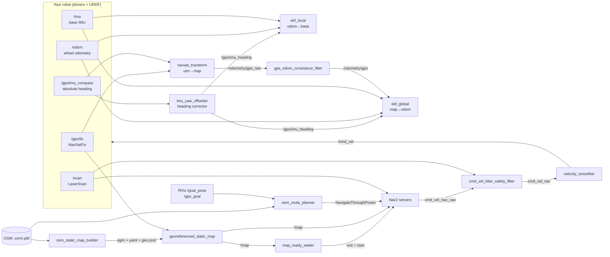

# Nodes: what each one solves, and why it exists

Outdoor GPS navigation fails in small, specific ways: a GPS that's confidently wrong, a compass
that disagrees with odometry, a map that's off by a few metres, a planner that starts too early.
Each node in this package fixes one of those failure modes. Together they make an off-the-shelf
Nav2 behave like a vehicle that knows where the road is.

---

## Localization layer

### `gps_odom_covariance_filter`: stop GPS from overpowering the robot's own sense of motion

**Problem.** A consumer (non-RTK) GPS often reports a horizontal sigma of about 1 m while the real
error is 3–5 m and wanders. An EKF believes the reported covariance, so every GPS update yanks the
pose sideways. The robot weaves, Nav2 replans, and the route looks drunk.

**What it does.** It sits between `navsat_transform` and `ekf_global`, copies each GPS odometry
message, and raises the position variance to a configurable floor (`gps_odom_min_horizontal_sigma_m`,
3 m by default). It only ever makes GPS *less* trusted, never more. Wheel odometry and the IMU
carry the short-term motion, and GPS slowly pulls the estimate back to the truth.

| | |
|---|---|
| In | `/odometry/gps_raw` (`nav_msgs/Odometry`) |
| Out | `/odometry/gps`, `/gps_odom_filter/status` (rate, age, in/out covariance) |
| Key params | `min_horizontal_variance_m2`, `min_vertical_variance_m2` (set from the launch sigma args) |

### `imu_yaw_offsetter` (launched as `gps_imu_heading_corrector`): separate *earth* heading from *robot* heading

**Problem.** One compass reading serves two jobs. `navsat_transform` needs the true earth heading
to line up UTM, map and OSM. The EKFs need the heading of the *robot body*. If the IMU is mounted
rotated, mirrored or backward, correcting it in one place breaks the other. The usual symptom is
a map that's correct while the robot drives at 90° or 180° to its plan.

**What it does.** It republishes the heading IMU with a planar yaw correction (`heading_invert_yaw`,
`heading_yaw_offset`, plus `magnetic_declination`) on `/gps/imu_heading`. Only the EKFs consume the
corrected topic. `navsat_transform` keeps reading the raw compass, so the earth alignment of the
map never moves when you tune the robot heading. It also drops zero-timestamp messages, which
would otherwise confuse `robot_localization`.

| | |
|---|---|
| In | `heading_imu_topic` (default `/gps/imu_compass`) |
| Out | `/gps/imu_heading` |
| Key params | `invert_yaw`, `yaw_offset`, `frame_id` (= `base_frame`), `drop_zero_stamp` |

### `ekf_local`, `ekf_global`, `navsat_transform` (robot_localization, configured in `config/ekf_gps.yaml`)

**Design.** This is the standard two-filter layout with one important detail. **Both** filters fuse
the same corrected absolute heading (`imu1`). Nav2's controller reasons in `odom` and the planner
in `map`. If `odom → base` is free to drift in yaw while `map` is earth-anchored, the two frames can
end up tens of degrees apart, and the controller fights the planner.

- `ekf_local`: wheel odometry velocity + base IMU yaw rate + corrected heading. Publishes
  `odom → base_footprint`. That's why your base must **not** publish that TF in GPS mode.
- `ekf_global`: the same inputs plus filtered GPS position. Publishes `map → odom`.
- `navsat_transform`: converts NavSatFix into map-frame odometry and broadcasts `utm → map`, which
  the OSM nodes use to place lat/lon on the map.

---

## Map layer (OpenStreetMap)

### `osm_loader`: read OpenStreetMap with no extra dependencies

**Problem.** OSM extracts come as `.osm` XML or compact `.osm.pbf`. Typical PBF readers pull in
native libraries that are awkward on robot computers.

**What it does.** It's a small pure-Python parser for both formats that returns only what
navigation needs: nodes, ways and tags. The route planner, map builder, georeferencing node and
startup monitor all share it, so they all see the same road graph.

### `osm_static_map_builder`: turn free map data into a drivable costmap, with no mapping run

**Problem.** Nav2's global planner needs a world model. Outdoors, building one with SLAM is slow,
site-specific and fragile (open fields, few features). Without one, the planner happily cuts
across grass, car parks and flowerbeds.

**What it does.** It rasterizes the OSM extract into a standard Nav2 map (`.pgm` + `.yaml`) plus a
`.geo.json` georeference:
- Every road or path in `allowed_highway_types` becomes a **free corridor** `road_buffer_m` wide on
  each side. Keep this wider than your GPS error.
- With `unknown_as_occupied` (default), everything off-road is **occupied**, so Nav2 physically
  can't plan a shortcut across non-road space.
- Buildings and barriers can optionally be burned in as obstacles (`osm_static_map_include_buildings`).
  This is off by default, because misaligned building outlines create false walls.

It runs once at launch, and Nav2 waits for it.

### `georeferenced_static_map`: line the map up with the real world at every startup

**Problem.** A static map has a fixed origin, but the robot's `map` frame starts wherever the robot
was powered on. Hand-editing a YAML origin for every start position doesn't scale.

**What it does.** It waits for a valid GPS fix and for the `map → base` and `map → utm` TFs, then
computes where the OSM map's reference corner sits in the live `map` frame. It averages several
samples (`georef_samples_required`, with a circular mean for yaw), freezes the result and publishes
`/map` as a latched OccupancyGrid. With `snap_static_map_to_graph`, the starting GPS position is first
snapped onto the nearest road, because a robot starting on a road shouldn't appear 3 m into a
field just because GPS is biased.

| | |
|---|---|
| In | `gps_fix_topic`, TF, the builder's `.yaml/.pgm/.geo.json`, the OSM file |
| Out | `/map` (transient local) |
| Key params | `samples_required`, `snap_reference_to_graph`, `max_snap_distance_m`, `align_map_yaw_to_utm` |

### `map_ready_waiter`: never start Nav2 against an empty map

**Problem.** If Nav2's static layer comes up before `/map` exists, the costmap bounds are invalid
and every goal is rejected. The resulting errors look like planner bugs.

**What it does.** It subscribes to `/map`, ignores empty or malformed grids, and **exits** as soon as
a usable map arrives. The launch file starts the Nav2 servers on that process exit, so the order
is guaranteed rather than guessed with a timer.

---

## Goal and route layer

### `osm_route_planner`: "Google Maps" routing for Nav2

**Problem.** Nav2 plans the shortest collision-free path on a grid. Outdoors that's rarely the path
you want: it doesn't know which way the road goes, and long goals fall outside a rolling costmap.

**What it does.** It's a two-layer planner. OSM decides *which roads*, and Nav2 decides *how to drive
them* while the local costmap still dodges obstacles.
1. It builds a weighted graph from the OSM ways and runs **A\*** from the robot to the goal.
2. It **snaps** the start and goal onto the nearest road *segment*, not just the nearest node, with
   a heading-aware penalty (`snap_heading_weight_m`). At a junction, an RViz arrow pointing north
   picks the north-south road.
3. It densifies the route (`osm_waypoint_spacing_m`), **prunes** points already behind the robot,
   and simplifies the poses with Ramer–Douglas–Peucker to at most `osm_nav2_max_waypoints`. Nav2
   gets a lean route that still keeps every real turn.
4. It sends the whole route as **one `NavigateThroughPoses` action**, so turns are planned as part
   of a single global path instead of stop-and-go waypoints (`follow_waypoints` is optional).

**Goals accepted:**
- RViz `/goal_pose`: converted to lat/lon, then routed on the roads. `bt_navigator`'s own
  `/goal_pose` is remapped away, so only one plan exists.
- `/gps_goal` (`geographic_msgs/GeoPoseStamped`): routed on the roads with an OSM file, or sent as a
  direct Nav2 goal without one.

| | |
|---|---|
| Out | `/osm_route_plan` (Path), `/osm_route_markers`, `/osm_graph_markers`, `/osm_route_status` |
| Key params | `max_snap_distance_m`, `snap_heading_weight_m`, `osm_nav2_max_waypoints`, `osm_nav2_simplify_tolerance_m`, `short_goal_direct_distance_m`, `nav2_action_mode` |

### `utm_goal_bridge`: click goals in an earth frame

**Problem.** It's convenient to set RViz's fixed frame to `utm`, so satellite-aligned overlays and
surveyed coordinates line up. Nav2 only accepts goals in `map`.

**What it does.** It transforms goals from `/goal_pose_utm` (frame `utm`) into `map` and republishes
them on `/goal_pose`. Without an OSM file it also sends them straight to `NavigateToPose`.

---

## Safety and observability

### `cmd_vel_lidar_safety_filter`: a last line of defence that doesn't depend on the planner

**Problem.** Costmaps lag, depth sensors wash out in sunlight, and a planner can still command
forward motion into something it hasn't marked yet.

**What it does.** It sits between the controller and the velocity smoother and reads the raw
LiDAR. If the closest return inside the forward sector (`safety_front_angles_deg` ± 40°) is within
`safety_slow_distance_m`, forward speed is capped. Within `safety_stop_distance_m`, forward motion
is blocked, together with its turn component. A stale scan also blocks forward motion, so a dead
LiDAR can't mean "all clear". Commands without forward motion (rotate in place, reverse) pass
through unchanged, so recoveries still work.

| | |
|---|---|
| In | `/cmd_vel_nav_raw`, `scan_topic` (+ `backup_scan_topic`) |
| Out | `/cmd_vel_nav`, `/cmd_vel_safety/status` |

### `startup_quality_monitor`: know when the robot is safe to send

**Problem.** In the first seconds after power-on, GPS may be off the road by tens of metres, and a
route planned from there starts in the wrong place.

**What it does.** It checks every fix against the OSM road graph. Readiness needs the fix to be
within `max_graph_snap_distance_m` of a road **and** a horizontal sigma below
`startup_quality_max_horizontal_sigma_m`, for `startup_quality_required_good_samples` consecutive
samples. It publishes `/startup_quality/ready` (Bool), `/startup_quality/metrics` and a readable
`/startup_quality/status`. A mission layer can wait on `ready` before sending goals.

### `outdoor_nav_health_monitor`: one line that tells you what's alive

**Problem.** Outdoor failures are often just a sensor that silently stopped publishing, or odometry
reporting motion while the wheels stand still.

**What it does.** It tracks the live rate and age of every input and output in the pipeline (GPS,
both IMUs with yaw, raw and filtered odometry with twist, GPS odometry and each stage of
`cmd_vel`) and publishes one summary line per second on `/outdoor_nav_health/status`.

### `yaw_debug_monitor`: debug heading in degrees, not quaternions

**Problem.** Most outdoor problems turn out to be heading problems: a sign flip, a 90° mount error,
or declination.

**What it does.** It publishes the corrected GPS-IMU heading, base-IMU yaw and filtered odometry yaw
side by side, in degrees, along with their pairwise differences (`/yaw_debug/yaws_deg`,
`/yaw_debug/delta_deg`, `/yaw_debug/status`). If the deltas aren't near zero while driving straight,
fix `heading_invert_yaw` / `heading_yaw_offset` before tuning anything else.

### `sensor_fallback_monitor`: which obstacle sensor is alive

It reports whether the depth camera or the LiDAR is currently the live obstacle source, based on
message age, on `/sensor_fallback/status`. LiDAR is the default outdoors, because depth clouds are
noisy in direct sunlight.

---

## Launch helper

### `launch_utils.render_nav2_params`: one tuned YAML for every robot

**Problem.** Tuned Nav2 params hard-code frame and topic names, and every robot differs slightly.
Forking the YAML per robot means losing the tuning.

**What it does.** At launch it writes a temporary copy of the params with only the *names*
substituted: the behavior-tree directory, `base_frame`, the LiDAR topic(s), and dropping the second
LiDAR source when you don't have one. The tuned numbers are never touched.
